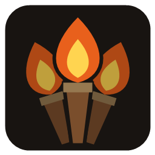
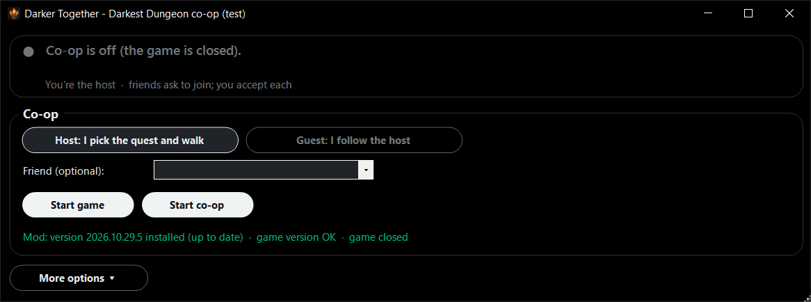

  

<h1 align="center">Darker Together</h1>

  <b>Co-op for Darkest Dungeon.</b> Up to four players, one dungeon, every campaign your own.

  <a href="https://github.com/Darklight0121/Darker-Together/releases/latest"><b>Download the latest release</b></a>

---

Darker Together lets friends take on the Hamlet's expeditions together. Each of you keeps your own
campaign, your own roster and your own Hamlet. When you meet, your heroes march into the same
dungeon side by side: you play your heroes, your friends play theirs, and every game sees the same
rooms, the same curios and the same battles. When the expedition ends, everyone's heroes go home to
their own Hamlet with what they found.

> **Early test.** It works, it has been played, and it still has rough edges. Use a campaign you
> don't mind testing with, or keep a copy of your saves.

## How a co-op expedition works

| Players | Heroes in the party |
| --- | --- |
| 2 | two each |
| 3 | the host brings two, each guest one |
| 4 | one each |

- **The host leads.** The host picks the quest, walks the party and picks the rooms; everyone else's
  party follows on their own screen.
- **You play your own heroes.** In battle, each hero's owner takes its turn. Out of battle, everyone
  can open curios, disarm traps, use items and camping skills, always with their own heroes. Your
  hero barks "Your turn!" and the taskbar flashes when it's yours.
- **Your own pack, your own loot.** Each of you buys your own provisions, eats your own food, and
  rolls and keeps your own loot.
- **Your heroes stay yours.** Nobody else can move your heroes or touch their trinkets. A hero that
  dies is dead in its owner's campaign, as usual.
- **Every game stays in step.** The games share their dice, so every attack, curio and trap turns out
  the same everywhere. They also check each other as you go, and if they ever disagree, one press of
  **Re-sync** reloads everyone from the host's game.

## Everything in one window

  

The kit comes with a small window that does all the work: it installs the mod, starts the game,
connects you, and keeps itself up to date from this page. It only shows the buttons that apply right
now, and every button explains itself when you rest the mouse on it.

- **Join through Steam.** Once the host starts co-op, friends see **Join Game** on the host's name in
  their Steam friends list, or get an invite from the host's **Invite friends** button. The host
  accepts or denies each player.
- **Updates.** When a new version is out, an **Update now** button appears. Everyone playing together
  needs the same version.
- **More options** has the rest: re-sync, quick saves (a safety copy of your campaign before a risky
  expedition), turn alerts, and the mod's log with every player's log one click away.

## Getting started

1. Download `DD_Coop_Test.zip` from the [latest release](https://github.com/Darklight0121/Darker-Together/releases/latest) and unzip it anywhere.
2. Double-click **`Darkest Dungeon Co-op.bat`**. (If Windows says "Windows protected your PC", click
   *More info*, then *Run anyway*.)
3. With the game closed, press **Install mod**.
4. Press **Start game**. One of you picks **Host** and presses **Start co-op**. Everyone else picks
   **Guest**, types the host's Steam name and presses **Start co-op** (or uses **Join Game** in Steam).
5. Load your campaigns, put your heroes in the party, and embark together from the Hamlet.

`READ ME FIRST.txt` in the zip explains everything in detail.

## Requirements

- Darkest Dungeon (the first game) on **Windows**, through **Steam**.
- Everyone on the **same game version** (no beta branch), with the **same DLC** and **no other mods**.
  The mod checks this when you connect and tells you if something differs.
- Campaigns with the same game mode and gameplay options. Linked campaigns, where you play every
  expedition together from a new campaign, stay in step week by week.

## What's in good shape and what isn't yet

- **Two players** is the main way to play and the most tested.
- **Three or four players** is **experimental**: embarking, walking, battles, curios, hunger,
  camping, loot and re-sync all work, but so far it has been tested with several copies of the game
  on one PC, not with real friends over the internet.
- Tested most in the Ruins and in the Color of Madness's Farmstead. Special bosses (the Hag, the Siren,
  the Drowned Crew, the Fanatic) have co-op handling but haven't been fought in co-op yet. The final
  Darkest Dungeon quests haven't been tried.

Found something odd? Every game sends its log to the others while you're connected, so whoever
reports it has everyone's.

## Safety and privacy

- The mod never edits your saves. The game saves your campaign as it always does.
- It talks only to the players in your co-op, directly over Steam's friend-to-friend connection, and
  shows your co-op status to your Steam friends. Nothing else goes anywhere.
- The window only contacts this GitHub page, to check for and download updates.
- To remove it, press **Uninstall** in the window (under *More options*) with the game closed.

## Credits

Made by **Darklight0121**, with Claude (Anthropic) writing the mod, the kit window and the tools.

Darker Together is an unofficial fan project, not affiliated with or endorsed by Red Hook Studios.
Darkest Dungeon is a trademark of Red Hook Studios.
